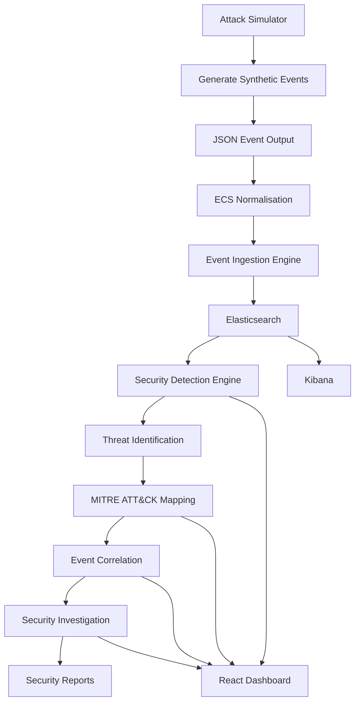
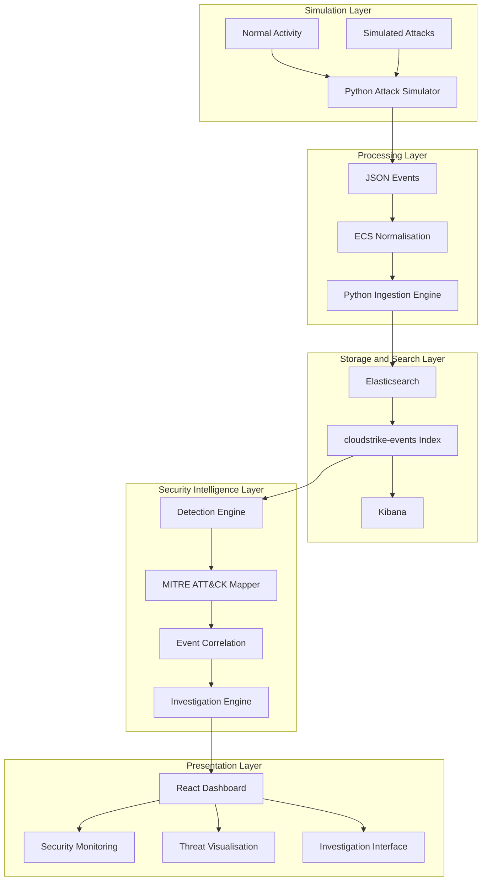
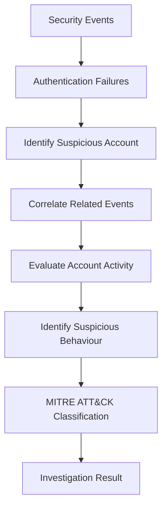

<div align="center">

# CloudStrike ⚡

### Simulate. Detect. Investigate.

**An intelligent security monitoring and threat detection platform that simulates cyberattacks, processes security events, identifies suspicious activity and supports security investigations through Elasticsearch, MITRE ATT&CK mapping and an interactive React dashboard.**


*An end-to-end Security Operations Centre (SOC) monitoring and threat detection project.*

**Developed by Mohammed Zuoriki**

</div>

---

## Table of Contents

1. [Overview](#overview)
2. [Project Objectives](#project-objectives)
3. [Key Features](#key-features)
4. [Attack Simulation Scenarios](#attack-simulation-scenarios)
5. [Security Monitoring Workflow](#security-monitoring-workflow)
6. [Technical Architecture](#technical-architecture)
7. [Technology Stack](#technology-stack)
8. [Event Structure and ECS Normalisation](#event-structure-and-ecs-normalisation)
9. [Threat Detection and MITRE ATT&CK](#threat-detection-and-mitre-attck)
10. [Event Correlation and Investigation](#event-correlation-and-investigation)
11. [React Security Dashboard](#react-security-dashboard)
12. [Project Structure](#project-structure)
13. [Getting Started](#getting-started)
14. [Running CloudStrike](#running-cloudstrike)
15. [Elasticsearch and Kibana](#elasticsearch-and-kibana)
16. [Testing and Validation](#testing-and-validation)
17. [Security Considerations](#security-considerations)
18. [Current Limitations](#current-limitations)
19. [Future Improvements](#future-improvements)
20. [Acknowledgements](#acknowledgements)
21. [Disclaimer](#disclaimer)

---

## Overview

**CloudStrike** is a Python-based security monitoring and threat detection platform designed to demonstrate how security events can be generated, processed, analysed and investigated within a modern Security Operations Centre (SOC) environment.

The project simulates different cyberattack scenarios, generates structured security events, normalises them into the Elastic Common Schema (ECS), and ingests them into Elasticsearch for centralised storage and analysis.

A detection engine evaluates incoming events against predefined security rules, identifies suspicious behaviour, maps detected threats to the MITRE ATT&CK framework and generates alerts for further investigation.

The platform also incorporates an interactive React dashboard, providing a visual interface for exploring security events, monitoring detected threats and understanding the security posture of the simulated environment.

CloudStrike brings together several important cybersecurity engineering concepts:

- Security event generation and simulation.
- Security Information and Event Management (SIEM).
- Log ingestion and normalisation.
- Threat detection and rule-based analysis.
- MITRE ATT&CK threat classification.
- Event correlation and investigation.
- Security monitoring and data visualisation.

### What can CloudStrike do?

| Capability | Description |
|---|---|
| **Simulate** | Generate realistic synthetic security events representing different attack scenarios. |
| **Collect** | Process and ingest security events into Elasticsearch. |
| **Normalise** | Convert raw event information into a consistent ECS-compatible structure. |
| **Detect** | Identify suspicious activity through predefined detection rules. |
| **Classify** | Associate detected threats with relevant MITRE ATT&CK techniques. |
| **Correlate** | Identify relationships between security events and suspicious activity. |
| **Investigate** | Support the analysis of detected threats and their associated events. |
| **Visualise** | Present security information through an interactive React dashboard. |

The overall objective is to demonstrate an end-to-end security monitoring pipeline, from simulated attack activity to security detection and investigation.

---

## Project Objectives

CloudStrike was developed around six main objectives.

| Objective | Description |
|---|---|
| Security simulation | Reproduce common cyberattack behaviours through controlled synthetic events. |
| Centralised monitoring | Establish a centralised platform for collecting and analysing security events. |
| Data normalisation | Implement consistent event structures using the Elastic Common Schema. |
| Threat detection | Develop detection logic capable of identifying suspicious activities. |
| Threat intelligence | Integrate MITRE ATT&CK techniques into the detection and investigation workflow. |
| Security visualisation | Develop a dashboard for monitoring security activity and presenting detection results. |

The project aims to demonstrate how multiple security technologies can work together to create a simplified SOC monitoring environment.

---

## Key Features

### 1. Automated Attack Simulation

CloudStrike includes a Python-based attack simulator responsible for generating synthetic security events.

The simulator reproduces different attack scenarios and generates structured JSON events that represent both normal and suspicious activity.

Features include:

- Automated event generation.
- Multiple attack scenarios.
- Normal user activity simulation.
- Structured JSON event output.
- Configurable event generation.
- Realistic timestamps and event attributes.

The simulator provides a controlled environment for testing the detection engine without conducting attacks against real systems.

### 2. Elasticsearch Integration

CloudStrike uses Elasticsearch as its centralised security event storage and search engine.

The integration enables the platform to:

- Establish a connection to Elasticsearch.
- Submit structured security events.
- Store events in a dedicated index.
- Retrieve previously ingested events.
- Search and analyse security activity.
- Support downstream detection and investigation workflows.

**Primary Elasticsearch index:**

```text
cloudstrike-events
```

### 3. ECS Event Normalisation

Raw security events are transformed into a consistent structure using the Elastic Common Schema (ECS).

This allows different types of security events to be represented using standardised field names.

Normalised event categories include:

- Authentication.
- Identity and access management (IAM).
- Network and file activity.

ECS normalisation makes it easier to search, correlate and analyse security information across different event types.

### 4. Rule-Based Threat Detection

The detection engine analyses security events against predefined detection conditions.

It identifies suspicious patterns and generates security alerts when specific conditions are met.

Detection capabilities include:

- Repeated failed authentication attempts.
- Password spraying activity.
- Suspicious privilege changes.
- Unauthorised account creation.
- Suspicious data transfer activity.

### 5. MITRE ATT&CK Mapping

Detected activities are associated with relevant MITRE ATT&CK techniques.

This provides a standardised way of describing attacker behaviour and understanding the techniques represented by the simulated scenarios.

Each applicable detection can be associated with:

- MITRE ATT&CK tactic.
- Technique identifier.
- Technique name.
- Detection description.
- Associated security events.

### 6. Event Correlation

CloudStrike incorporates event correlation to identify relationships between individual security events.

Rather than examining every event independently, correlation logic helps identify patterns that may indicate a broader attack sequence.

Examples include:

- Multiple failed login attempts associated with the same account.
- Suspicious authentication activity followed by successful access.
- Privilege changes associated with unusual account behaviour.
- Related network activity following suspicious authentication events.

### 7. Security Investigation

The investigation component supports the examination of detected security activity.

It brings together relevant information from detection results, event records and MITRE ATT&CK classifications.

This provides a foundation for understanding:

- What happened?
- Which events triggered the detection?
- Which accounts or resources were involved?
- Which attack technique was identified?
- What evidence supports the alert?

### 8. Interactive React Dashboard

CloudStrike includes a React-based frontend dashboard designed to make security monitoring more accessible.

The dashboard provides a graphical interface for presenting information from the security monitoring pipeline.

Its intended monitoring experience includes:

- Security overview.
- Event monitoring.
- Threat detection summaries.
- Alert visibility.
- Attack classification.
- MITRE ATT&CK information.
- Security activity visualisation.

The dashboard connects the underlying security monitoring capabilities with a more accessible user experience.

---

## Attack Simulation Scenarios

CloudStrike currently focuses on five representative attack scenarios.

The simulator generates a total of **45 synthetic security events**, combining normal activity and simulated suspicious behaviour.

### Scenario Overview

| Scenario | Event Count | MITRE ATT&CK Technique |
|---|---:|---|
| Normal user activity | 20 | N/A |
| Brute-force attack | 10 | T1110.001 |
| Password spraying | 5 | T1110.003 |
| Privilege escalation activity | 3 | T1098 |
| Unauthorised account creation | 2 | T1136 |
| Suspicious data exfiltration | 5 | T1567 |
| **Total** | **45** | |

### 1. Brute-Force Attack

**MITRE ATT&CK: T1110.001 – Password Guessing**

Simulates repeated authentication attempts against a target account.

The objective is to demonstrate how repeated failed login attempts can indicate password-guessing activity.

Detection indicators:

- Repeated authentication failures.
- Multiple login attempts.
- Unusual authentication frequency.
- Suspicious activity against a specific account.

### 2. Password Spraying

**MITRE ATT&CK: T1110.003 – Password Spraying**

Simulates an attacker attempting a common password against multiple user accounts.

Unlike traditional brute-force attacks, password spraying distributes attempts across several accounts.

Detection indicators:

- Multiple accounts targeted.
- Similar authentication failure patterns.
- Repeated attempts using a common password.
- Suspicious authentication activity across users.

### 3. Privilege Escalation

**MITRE ATT&CK: T1098 – Account Manipulation**

Simulates suspicious account modification and privilege-related activity.

Detection indicators:

- Unexpected account changes.
- Suspicious privilege modifications.
- Unusual identity management activity.
- Changes to account permissions.

### 4. Unauthorised Account Creation

**MITRE ATT&CK: T1136 – Create Account**

Simulates the creation of an account without appropriate authorisation.

Detection indicators:

- Unexpected account creation.
- New user identities.
- Suspicious account management activity.
- Potential persistence-related behaviour.

### 5. Suspicious Data Exfiltration

**MITRE ATT&CK: T1567 – Exfiltration Over Web Service**

Simulates suspicious outbound data transfer activity.

Detection indicators:

- Unusual outbound network activity.
- Suspicious data transfer patterns.
- Potential unauthorised data movement.
- Abnormal network behaviour.

> These scenarios use synthetic data and controlled simulation logic. They are designed to demonstrate detection concepts rather than execute real attacks.

---

## Security Monitoring Workflow

CloudStrike follows an end-to-end security monitoring workflow.

### Event Processing Pipeline



### Processing Stages

| Stage | Component | Responsibility |
|---|---|---|
| 1 | Attack Simulator | Generates normal and suspicious security events. |
| 2 | JSON Generator | Structures the generated events. |
| 3 | ECS Normaliser | Converts raw events into standardised ECS-compatible records. |
| 4 | Ingestion Engine | Sends normalised events to Elasticsearch. |
| 5 | Elasticsearch | Stores and indexes security events. |
| 6 | Detection Engine | Evaluates events against predefined detection rules. |
| 7 | MITRE Mapper | Associates detected activity with attack techniques. |
| 8 | Correlation Engine | Identifies relationships between security events. |
| 9 | Investigation Engine | Supports analysis of detected security activity. |
| 10 | Reporting and Dashboard | Presents security information for monitoring and investigation. |

---

## Technical Architecture

CloudStrike uses a modular architecture that separates event generation, data processing, security detection and visualisation.

### Backend Architecture

The Python backend handles the main security monitoring functionality.

Its responsibilities include:

- Generating simulated security events.
- Normalising event structures.
- Connecting to Elasticsearch.
- Ingesting and retrieving events.
- Executing detection rules.
- Mapping threats to MITRE ATT&CK.
- Correlating security activity.
- Supporting investigation and reporting.

### Data Storage Architecture

Elasticsearch provides centralised storage and indexing.

The application uses the `cloudstrike-events` index to store normalised security events.

Kibana provides an additional interface for exploring indexed information and supporting security analysis.

### Frontend Architecture

The React dashboard provides a graphical interface for the security monitoring environment.

It is designed to present information from the backend in a more accessible and structured format.

### Architecture Diagram



---

## Technology Stack

| Category | Technology | Purpose |
|---|---|---|
| Backend | Python 3 | Event generation, processing and security detection. |
| Frontend | React | Interactive security monitoring dashboard. |
| Frontend language | JavaScript | Dashboard logic and interactions. |
| Styling | CSS3 | Dashboard layout and visual presentation. |
| Search and analytics | Elasticsearch | Centralised security event storage and searching. |
| Visualisation | Kibana | Security data exploration and monitoring. |
| Containerisation | Docker | Running the Elasticsearch environment. |
| Orchestration | Docker Compose | Managing containerised services. |
| Data format | JSON | Structured security event representation. |
| Data standard | Elastic Common Schema | Standardised security event fields. |
| Threat framework | MITRE ATT&CK | Classification of simulated attacker behaviour. |
| Backend integration | Elasticsearch Python Client | Communication between Python and Elasticsearch. |
| Configuration | Environment variables | Secure configuration of application settings. |

---

## Event Structure and ECS Normalisation

CloudStrike uses JSON as its primary event interchange format.

Raw events are processed through the ECS normalisation component before being ingested into Elasticsearch.

### Example Event

The following illustrates the intended structure of a normalised authentication event:

```json
{
  "@timestamp": "2026-11-22T12:30:00Z",
  "event": {
    "category": ["authentication"],
    "type": ["start"],
    "action": "user-login",
    "outcome": "failure"
  },
  "user": {
    "name": "test_user"
  },
  "source": {
    "ip": "192.0.2.10"
  },
  "host": {
    "name": "cloudstrike-endpoint"
  },
  "service": {
    "type": "authentication"
  }
}
```

*Illustrative ECS-compatible example, not a claim that this exact record was generated during testing.*

### Why ECS?

The Elastic Common Schema provides a consistent naming convention for event fields.

This helps CloudStrike:

- Standardise different event types.
- Improve Elasticsearch search queries.
- Simplify detection logic.
- Support event correlation.
- Improve compatibility with Elastic security tooling.
- Make security information easier to investigate.

---

## Threat Detection and MITRE ATT&CK

CloudStrike uses predefined detection logic to identify suspicious behaviour within the ingested security events.

### Detection Process

1. Retrieve relevant security events.
2. Examine event attributes.
3. Evaluate predefined detection conditions.
4. Identify suspicious patterns.
5. Generate detection results.
6. Associate applicable MITRE ATT&CK techniques.
7. Pass relevant information to the correlation and investigation components.

### MITRE ATT&CK Integration

CloudStrike uses the MITRE ATT&CK framework to provide context around simulated attack behaviours.

| Attack Scenario | Technique ID | Technique |
|---|---|---|
| Brute-force attack | T1110.001 | Password Guessing |
| Password spraying | T1110.003 | Password Spraying |
| Privilege-related activity | T1098 | Account Manipulation |
| Unauthorised account creation | T1136 | Create Account |
| Suspicious data exfiltration | T1567 | Exfiltration Over Web Service |

**Framework reference:** [MITRE ATT&CK](https://attack.mitre.org/)

Mapping detections to MITRE ATT&CK helps connect individual security events to recognised adversary techniques.

---

## Event Correlation and Investigation

Individual security events do not always provide enough context to understand an attack.

CloudStrike incorporates event correlation to help identify relationships between different activities.

### Example Investigation Workflow



### Investigation Objectives

The investigation component aims to provide useful context around detected security activity.

| Investigation Area | Purpose |
|---|---|
| Event identification | Identify the events associated with an alert. |
| User activity | Understand which accounts were involved. |
| Timeline analysis | Examine the sequence of suspicious activity. |
| Attack classification | Identify relevant MITRE ATT&CK techniques. |
| Event correlation | Connect related security events. |
| Investigation reporting | Present findings in a structured format. |

---

## React Security Dashboard

CloudStrike includes a React-based dashboard to provide a visual representation of the monitoring environment.

The objective is to move beyond terminal-based output and introduce a more accessible interface for security monitoring.

### Dashboard Components

| Component | Purpose |
|---|---|
| Security Overview | Present a high-level summary of monitoring activity. |
| Event Monitoring | Display ingested security events. |
| Threat Detection | Present identified suspicious activity. |
| Alert Monitoring | Provide visibility into detection results. |
| MITRE ATT&CK | Display associated attack techniques. |
| Activity Visualisation | Present security activity through graphical elements. |
| Investigation | Provide context for analysing detected activity. |

### Frontend Architecture

The dashboard uses React to organise the user interface into reusable components.

This approach provides:

- Component-based development.
- Separation of interface and application logic.
- Reusable monitoring components.
- Dynamic rendering of security information.
- A foundation for future API integration.

### Future Dashboard Enhancements

Potential extensions include:

- Real-time event streaming.
- Advanced alert filtering.
- Interactive attack timelines.
- Severity-based alert categorisation.
- MITRE ATT&CK matrix visualisation.
- Investigation case management.
- Exportable security reports.

---

## Project Structure

CloudStrike follows a modular architecture to separate the responsibilities of individual components.

```text
CloudStrike/
│
├── simulator/
│   └── Attack simulation and synthetic event generation
│
├── elasticsearch/
│   ├── es_connector.py
│   ├── ecs_normalizer.py
│   └── ingest_events.py
│
├── detection/
│   └── Security detection rules and analysis
│
├── mitre/
│   └── MITRE ATT&CK technique mapping
│
├── investigation/
│   └── Event correlation and investigation logic
│
├── reports/
│   └── Security investigation reports
│
├── dashboard/
│   └── React-based security monitoring interface
│
├── docker-compose.yml
│
├── requirements.txt
│
├── .env
│
├── .gitignore
│
├── main.py
│
└── README.md
```

*The structure represents the intended separation of project components. Individual filenames and frontend subdirectories should reflect the final repository implementation.*

### Component Responsibilities

| Directory / File | Responsibility |
|---|---|
| `simulator/` | Generates synthetic security events and simulated attack activity. |
| `elasticsearch/` | Handles Elasticsearch connectivity, ECS normalisation and ingestion. |
| `detection/` | Contains security detection logic. |
| `mitre/` | Maps detected activities to MITRE ATT&CK techniques. |
| `investigation/` | Supports event correlation and security investigations. |
| `reports/` | Contains reporting functionality. |
| `dashboard/` | Contains the React security monitoring interface. |
| `docker-compose.yml` | Defines containerised services. |
| `requirements.txt` | Lists Python dependencies. |
| `.env` | Stores local environment configuration. |
| `main.py` | Provides the main application entry point. |

---

## Getting Started

### Prerequisites

Before running CloudStrike, ensure the following tools are installed.

| Requirement | Purpose |
|---|---|
| Python 3.11+ | Backend development and execution. |
| Docker Desktop | Running Elasticsearch containers. |
| Docker Compose | Managing containerised services. |
| Node.js and npm | Running the React dashboard. |
| Visual Studio Code | Recommended development environment. |
| Git | Repository management. |
| Modern browser | Accessing Kibana and the dashboard. |

### 1. Clone the Repository

```bash
git clone https://github.com/Code-tech77/CloudStrike.git

cd CloudStrike
```

### 2. Create a Python Virtual Environment

```bash
python3 -m venv .venv
```

Activate the environment.

**macOS / Linux:**

```bash
source .venv/bin/activate
```

**Windows:**

```powershell
.venv\Scripts\activate
```

### 3. Install Python Dependencies

```bash
pip install -r requirements.txt
```

### 4. Configure Environment Variables

Create a `.env` file in the project root.

Example configuration:

```env
ELASTICSEARCH_URL=https://localhost:9200

ELASTICSEARCH_USERNAME=elastic

ELASTICSEARCH_PASSWORD=your_password

ELASTICSEARCH_INDEX=cloudstrike-events
```

Replace the example credentials with the values configured in your local Elasticsearch environment.

**Important:** Never commit `.env` or real credentials to GitHub.

### 5. Start Elasticsearch and Kibana

Start the containerised environment:

```bash
docker compose up -d
```

Check running containers:

```bash
docker compose ps
```

### 6. Verify Elasticsearch

Once Elasticsearch has started, verify connectivity:

```bash
curl -k https://localhost:9200
```

### 7. Access Kibana

Open:

```text
http://localhost:5601
```

Log in using the credentials configured for your local Elastic environment.

---

## Running CloudStrike

Once the environment has been configured, the application can be executed through its individual processing stages.

### Step 1: Generate Security Events

Run the attack simulator to generate synthetic security activity.

```bash
python main.py
```

If the simulator is exposed through a separate entry point in the final repository, execute that module instead.

### Step 2: Normalise Events

The generated JSON events are processed through the ECS normalisation component.

This ensures that event records follow a consistent structure before ingestion.

### Step 3: Ingest Events

The ingestion component connects to Elasticsearch and submits the normalised records.

The target index is:

```text
cloudstrike-events
```

### Step 4: Execute Threat Detection

The detection engine evaluates the available security events against the predefined detection conditions.

### Step 5: Map MITRE ATT&CK Techniques

Detected activities are associated with the relevant MITRE ATT&CK techniques.

### Step 6: Investigate Security Events

The investigation component examines related events and provides additional context around suspicious activity.

### Step 7: Launch the Dashboard

Navigate to the React dashboard directory:

```bash
cd dashboard
```

Install the frontend dependencies:

```bash
npm install
```

Start the development server using the script configured in `package.json`:

```bash
npm run dev
```

*The exact dashboard command depends on the frontend build configuration.*

---

## Elasticsearch and Kibana

CloudStrike uses Elasticsearch and Kibana as its central search and monitoring infrastructure.

### Elasticsearch Index

```text
cloudstrike-events
```

The index stores the normalised security event records.

### Example Elasticsearch Query

Retrieve the latest security events:

```json
GET cloudstrike-events/_search
{
  "size": 20,
  "sort": [
    {
      "@timestamp": {
        "order": "desc"
      }
    }
  ]
}
```

### Example: Authentication Failures

```json
GET cloudstrike-events/_search
{
  "query": {
    "bool": {
      "filter": [
        {
          "term": {
            "event.outcome": "failure"
          }
        },
        {
          "term": {
            "event.category": "authentication"
          }
        }
      ]
    }
  }
}
```

These queries demonstrate how ECS-compatible fields can be used to retrieve and investigate security events.

---

## Testing and Validation

Testing is an important part of the CloudStrike development process.

The project uses synthetic events to validate whether the monitoring pipeline can process and identify representative security activity.

### Validation Areas

| Test Area | Validation Objective |
|---|---|
| Event generation | Confirm that the simulator produces structured JSON records. |
| ECS normalisation | Verify that event fields follow the expected schema. |
| Elasticsearch connectivity | Confirm that the Python application can communicate with Elasticsearch. |
| Event ingestion | Verify that generated events are successfully indexed. |
| Event retrieval | Confirm that indexed events can be searched. |
| Threat detection | Validate detection logic against simulated attack scenarios. |
| MITRE mapping | Check that detections reference the expected techniques. |
| Event correlation | Examine relationships between related security events. |
| Investigation | Verify that relevant event context is available for analysis. |
| Dashboard | Validate the presentation of monitoring information. |

### Expected Simulation Dataset

The initial simulation dataset contains 45 events:

- 20 normal activity events.
- 10 brute-force events.
- 5 password spraying events.
- 3 privilege-related events.
- 2 unauthorised account creation events.
- 5 suspicious data exfiltration events.

The dataset provides a repeatable foundation for testing detection and analysis functionality.

### Detection Validation

The detection engine should be evaluated against both normal and suspicious activity.

Important validation considerations include:

- True positives.
- False positives.
- False negatives.
- Detection consistency.
- Correct MITRE ATT&CK classification.
- Correlation accuracy.

A successful ingestion process does not automatically demonstrate successful threat detection. Each stage should be validated independently.

---

## Security Considerations

CloudStrike is designed as a controlled security monitoring environment.

Several security considerations are important when running or extending the application.

### Credential Management

- Store Elasticsearch credentials in environment variables.
- Exclude `.env` from Git.
- Avoid hardcoding passwords in Python source files.
- Use appropriate authentication for Elasticsearch.

### Network Security

- Run the environment locally or within a controlled testing network.
- Avoid exposing Elasticsearch and Kibana directly to public networks.
- Use appropriate authentication and transport encryption.

### Data Integrity

- Use structured JSON event records.
- Validate incoming event attributes.
- Maintain consistent timestamps.
- Normalise records before ingestion.

### Simulation Safety

- Use synthetic data for attack simulation.
- Do not target external systems.
- Keep testing within authorised environments.

---

## Current Limitations

CloudStrike is a developing security monitoring platform, and its current implementation has several limitations.

| Area | Current Limitation |
|---|---|
| Event generation | Primarily relies on synthetic security events. |
| Threat detection | Uses predefined detection logic rather than a machine-learning detection model. |
| Data ingestion | Focuses on the simulated event pipeline rather than production endpoint telemetry. |
| MITRE ATT&CK | Covers the techniques represented by the current simulation scenarios. |
| Event correlation | Limited to the relationships implemented in the correlation logic. |
| Dashboard | Depends on the available backend integration and implemented monitoring components. |
| Production deployment | Requires additional hardening, scalability and operational testing. |

These limitations provide opportunities for further development.

---

## Future Improvements

CloudStrike establishes a foundation for more advanced security monitoring capabilities.

Potential future improvements include:

| Priority | Improvement | Potential Benefit |
|---|---|---|
| High | Real-time event streaming | Continuous security event monitoring. |
| High | Advanced detection rules | Identification of more complex attack patterns. |
| High | Expanded MITRE ATT&CK coverage | Broader threat classification. |
| High | Interactive investigation dashboard | Improved SOC analyst experience. |
| Medium | Machine-learning anomaly detection | Identification of unusual behaviour. |
| Medium | Automated alert prioritisation | More effective alert management. |
| Medium | Threat intelligence integration | Additional context for suspicious indicators. |
| Medium | Automated incident reporting | Structured investigation documentation. |
| Future | Cloud log integration | Monitoring events from cloud environments. |
| Future | Endpoint telemetry integration | Analysis of endpoint security events. |
| Future | Automated response workflows | Controlled response to confirmed security incidents. |

The longer-term direction is to extend CloudStrike towards a more comprehensive security monitoring and investigation platform.

---

## Acknowledgements

CloudStrike builds upon several established technologies and cybersecurity frameworks.

Special thanks to:

- **Elastic** for Elasticsearch, Kibana and the Elastic Common Schema.
- **MITRE** for the MITRE ATT&CK framework.
- **Docker** for containerisation technology.
- **React** for the frontend framework.
- **Python** for backend development and event processing.
- The open-source cybersecurity community for the tools, documentation and resources that support security engineering.

---

## Disclaimer

CloudStrike is an educational cybersecurity engineering project developed to demonstrate security event simulation, SIEM integration, threat detection, event correlation and security investigation.

All attack scenarios use synthetic events within a controlled environment.

The project is not intended to conduct unauthorised activities, compromise external systems or replace enterprise-grade security monitoring solutions.

Detection results depend on the implemented rules, simulated dataset and available event information.

**CloudStrike is intended for educational, research and authorised security testing purposes only.**

---

<div align="center">

# CloudStrike ⚡

### Simulate. Detect. Investigate.

**Turning security events into actionable intelligence.**

Developed by **Mohammed Zuoriki**

[GitHub](https://github.com/Code-tech77) · [LinkedIn](https://www.linkedin.com/)

</div>
